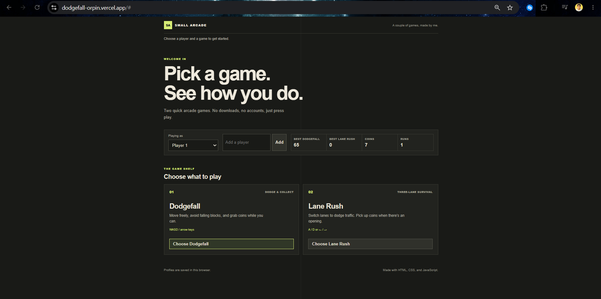
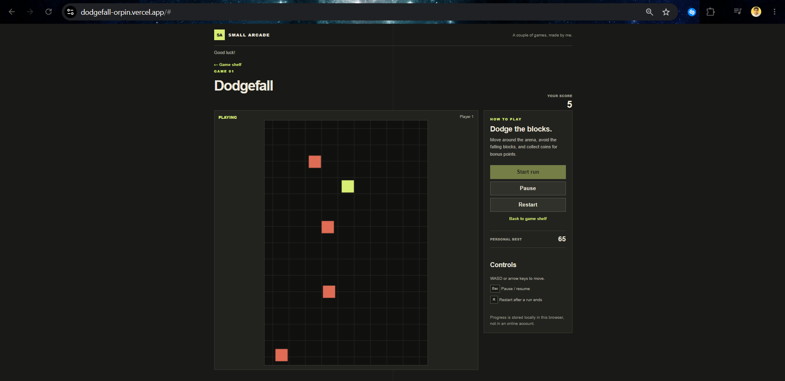
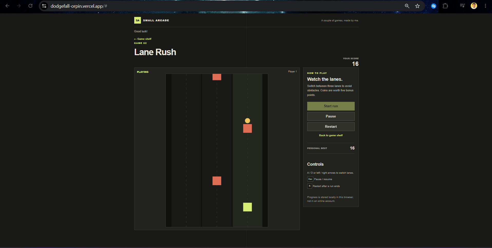
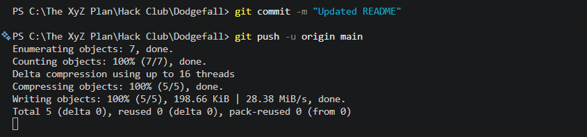

### Small Arcade Games

This is my browser arcade project, made with HTML, CSS, and JavaScript. It currently has two games: Dodgefall and Lane Rush.

# Dodgefall

Dodgefall is a small browser game I made with HTML, CSS, and JavaScript. You move around, dodge falling blocks, and try to get the highest score you can.

## How to play

- Press "Start game" from the menu.
- Move with "WASD" or the "arrow keys".
- Dodge the falling blocks. Each block you avoid is added to your score.
- Collect falling coins for extra points.
- The blocks get faster the longer you survive.
- Press "Esc" or use the pause button to pause or resume.
- If you get hit, press "R" or choose Play again to restart.

## Features

- Player profiles
- Best score, coin total, and games played for each profile
- Progress saved in the browser
- Falling blocks and collectible coins
- Menu, pause, restart, and Game Over screens

Profiles are saved in the browser itself.

## Run it

You don’t need to install any packages.

1. Download or clone this repository.
2. Open the project folder in VS Code.
3. Open `index.html` using a local server, such as the Live Server extension.
4. Click on Dodgefall and play!

or simply just open https://dodgefall-orpin.vercel.app/ :))

# Lane Rush

Lane Rush is a small browser game I made with HTML, CSS, and JavaScript. You switch lanes, dodge falling blocks, collecting coins, and try to get the highest score you can.

## How to play

- Press "Start game" from the menu.
- Move with "A" or "D" or the "right" and "left" keys.
- Dodge the falling blocks. Each block you avoid is added to your score.
- Collect falling coins for extra points.
- The blocks get faster the longer you survive.
- Press "Esc" or use the pause button to pause or resume.
- If you get hit, press "R" or choose Play again to restart.

## Features

- Player profiles
- Best score, coin total, and games played for each profile
- Progress saved in the browser
- Falling blocks and collectible coins
- Menu, pause, restart, and Game Over screens

Profiles are saved in the browser itself.

## Run it

You don’t need to install any packages.

1. Download or clone this repository.
2. Open the project folder in VS Code.
3. Open `index.html` using a local server, such as the Live Server extension.
4. Click on Lane-Rush and play!

or simply just open https://dodgefall-orpin.vercel.app/ :))

## Files

- `index.html` contains the arcade menu and game page.
- `css/style.css` styles the menu and game layout.
- `js/main.js` handles the menu, profiles, and game flow.
- `js/storage.js` loads and saves profile progress.
- `js/games/dodgefall.js` contains Dodgefall.
- `js/games/lane-rush.js` contains Lane Rush.
- `devlog.txt` contains notes about how I built the project.

## What I learned

While making this, I learned more about canvas games, keyboard controls, collision detection, game state, and saving data in the browser. 

## Screenshot

This is the website's screenshot - 

This is the Dodgefall Game's screenshot online - 

This is the Lane Rush Game;s screenshot online - 

## Repository

[View the project on GitHub](https://github.com/atireksd11/Dodgefall)

## Credits 

Help used: Copilot helped in fixing errors, troubleshooting, and helping me commit to github when it was stuck - 

Also help used from the Crescent's own guide - https://crescent.hackclub.com/guides/arcade
