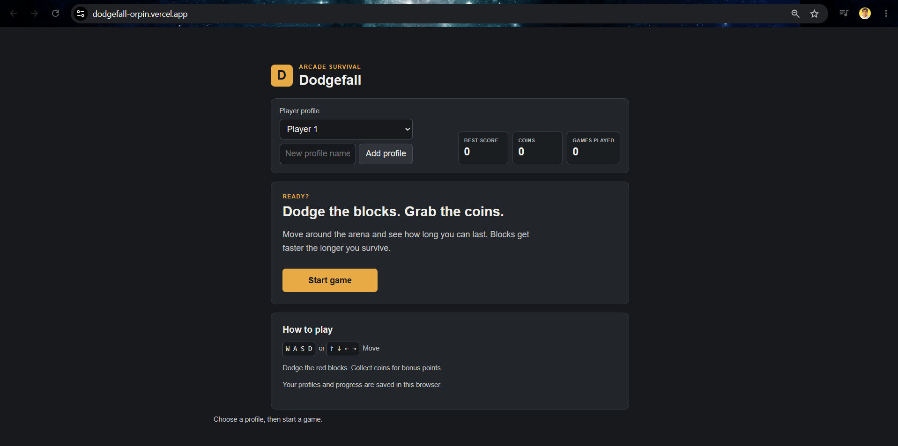
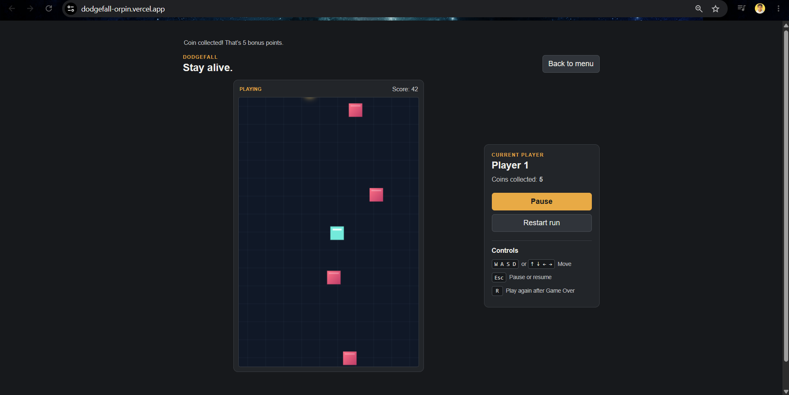

# Dodgefall

Dodgefall is a small browser game I made with HTML, CSS, and JavaScript. You move around, dodge falling blocks, and try to get the highest score you can.

## How to play

- Press "Start game" from the menu.
- Move with "WASD" or the "arrow keys".
- Dodge the falling blocks. Each block you avoid is added to your score.
- Collect falling coins for extra points.
- The blocks get faster the longer you survive.
- Press "Esc" or use the pause button to pause or resume.
- If you get hit, press "R" or choose Play again to restart.

## Features

- Player profiles
- Best score, coin total, and games played for each profile
- Progress saved in the browser
- Falling blocks and collectible coins
- Menu, pause, restart, and Game Over screens

Profiles are saved in the browser itself.

## Run it

You don’t need to install any packages.

1. Download or clone this repository.
2. Open the project folder in VS Code.
3. Open `index.html` using a local server, such as the Live Server extension.

or simply just open https://dodgefall-orpin.vercel.app/ :))

## Files

- `index.html` has the page structure and game menu.
- `css/style.css` styles the game and layout.
- `js/script.js` runs the game and handles controls, profiles, scoring, and saves.
- `devlog.txt` has notes about how I built the project.

## What I learned

While making this, I learned more about canvas games, keyboard controls, collision detection, game state, and saving data in the browser. 

## Ideas for later

I maybe, will add more visual customization, extra things to collect, or different games in a future version.

## Screenshot

This is the website's screenshot - 

This is the Game's screenshot online - 

## Repository

[View the project on GitHub](https://github.com/atireksd11/Dodgefall)